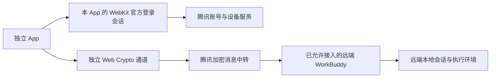

<!--
[INPUT]: 本机 WorkBuddy 5.9.3、当前用户授权和独立 App 实测。
[OUTPUT]: 提供可复核的协议验证结论、运行方式与未验证项。
[POS]: docs 的技术事实记录，README 链接到此处。
[PROTOCOL]: 变更时更新此头部，然后检查 CLAUDE.md
-->
# WorkBuddy 独立 Mac 远程接入验证

验证日期：2026-11-13（Asia/Shanghai）。这是授权的本人设备互操作验证，不是漏洞评估；报告 flavor 为 null。范围见私有工作目录 `work/workbuddy-local/scope.md`。

## 结论

独立 Mac App 可以使用普通账号的官方网页登录会话，发现同账号设备，并通过加密通道调用所选 Mac 上的本地会话。已在原生界面实际读取 3 台设备，连接其中一台并显示选定会话历史。最终构建完成分页读取，原生界面显示 196 个本地会话；重启后无需重新扫码即可再次读取设备并连接。

不需要控制端安装 WorkBuddy，也不需要开放平台注册应用。远端仍需运行 WorkBuddy，并主动允许远程接入。任务执行位于远端 Mac；腾讯服务承担账号与消息中转。未采用 iCloud 同步数据库或云端任务执行。

## Evidence → Finding → Path

| 证据 | 观察 | 结论 | 复现路径 |
|---|---|---|---|
| E-01 | 已安装 Edge Sync 的远程命令表包含本地会话列表、请求历史、发送、取消 | 存在比公开本地助理 API 更完整的远程通道 | `work/workbuddy-local/evidence/source/` 的本机静态取证材料 |
| E-02 | 本机鉴权 IPC 握手成功，后端返回当前账号设备与短期通道凭证 | 可先用现有会话验证协议，不代表最终客户端依赖它 | `python3 lib/bootstrap.py --private-dir work/workbuddy-local/private` |
| E-03 | 不加载厂商 SDK 的 `wire.mjs` 读取列表、详情和历史成功 | 原创通道实现已与真实主机互操作 | Node 导入 `RemoteChannel`，使用私有实验凭证调用 `request` |
| E-04 | 隔离会话共两轮，两个已完成助手回复均包含同一随机测试标记 | 发消息确实接续同一本地会话上下文 | 私有 `roundtrip-complete.json`，未公开账号和正文 |
| E-05 | 用户完成原型自己的网页登录，原生 UI 发现设备、读取另一台 Mac 的本地任务 | 自主登录与独立控制端路径已成立 | `dist/WorkBuddy Remote.app` → 登录 → 读取设备 → 连接 |
| E-06 | 15 项自动测试通过 | 已覆盖已实现部分的核心边界 | `node --test tests/*.test.mjs` |
| E-07 | 最终构建重启后恢复自主登录，分页加载 196 个本地会话 | 登录保留、分页与最终产物均已实测 | 最终 App 的原生设备与会话界面 |

## 数据与信任边界



每次选择设备后申请对应 `executor:设备ID` 的短期通道权限。回包通过带当前用户限定的 reply 通道传递。消息使用 AES-GCM 与 HMAC-SHA256，接收端先验签再解密，验证分片索引与密钥版本。

App 的运行资源只有本项目编译的原生程序与 `wire.mjs`。本机安装包仅用于早期协议取证，没有复制到发布 App。登录 Cookie 保存在 App 自己的 WebKit 数据存储；运行时通道凭证保存在内存中。私有实验凭证与原始回复位于 `work/`，不在发布目录。

## 功能边界与后续验证

当前 0.2.1 支持富文本历史、发送、停止、分页历史、定时刷新及按接口探测开放的目录。未接入的附件、语音、助理、资料库和主机设置入口已移除；工具审批专用组件和完整实时事件尚未接入。请求前会检查连接并刷新临近到期凭证，在途写入失败不重发。协议写入验证仅对本工具创建的隔离会话执行；没有向用户的业务会话发送测试消息。

独立网页登录和远程读取已通过实际 UI 验收，新版界面已在独立新建的 UI 验收任务完成两轮同标记回复。当前版本未做长期联网、休眠恢复、账号切换期间并发请求、所有系统版本和 Intel Mac 的运行验收。

## 构建与复核

从项目根目录运行：

```sh
zsh build.command
node --test tests/*.test.mjs
codesign --verify --deep --strict 'dist/WorkBuddy Remote.app'
```

开放平台公开接口与本次使用的普通登录通道不同，不需要在此原型中填写 client secret。官方背景资料：[多端协同](https://www.workbuddy.cn/docs/workbuddyapp/features/Multidevice)、[Open API](https://open.workbuddy.cn/docs/openapi)。内部协议的主要依据是本机安装包及真实同账号请求，不应将其描述成稳定公开 API。

## 断线复核

复核时观察到一次历史读取连接异常，原生错误提示已保留 JavaScript 原因。重连后历史加载恢复，已新增请求前连接检查、临近到期刷新和在途断线立即结束请求。新增两项断线测试通过；原生长时间休眠和完整网络切换仍未验证，不把一次恢复视为长期稳定性证明。
